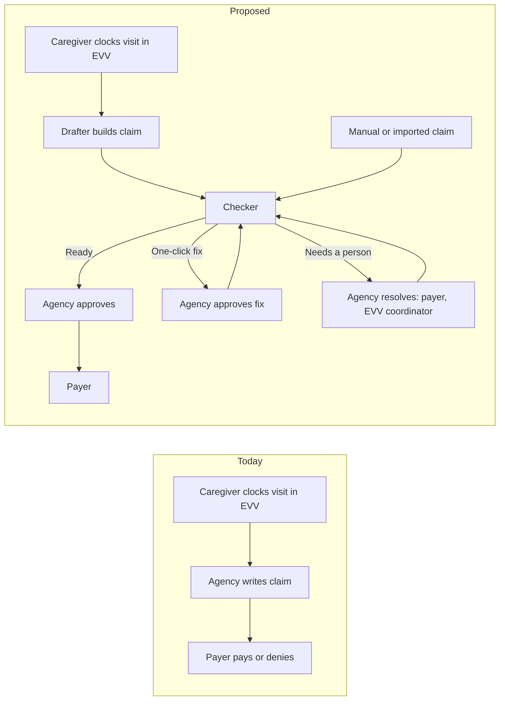

# Exchange4Health claims assistant

A prototype for home care agencies' billing teams. It checks claims against each payer's rules before submission, predicts which will be denied and why, and fixes what has one correct answer. It can also draft claims straight from verified EVV visits, so agencies stop writing them by hand.

On the synthetic data, the checker predicts the payer's paid or denied outcome for **3,768 of 3,830 historical claims (98.4%)**. Drafting claims from verified visits would have held **345 of 4,980 drafts (6.9%)** for review, against **1,099 of 3,830 claims (28.7%)** denied historically.

## The problem and what I tackled

Agencies write each claim by hand from the visits their caregivers log in EVV, then submit it to one of several payers, each with its own rules. In the history, 28.7% of claims were denied, mostly for errors that were visible before submission: units above the verified visit time, late filing, missing or wrong authorizations, wrong modifiers.

I tackled the step before submission, in two parts:

1. **Checker (short term).** Sits between the agency and the payer. Every claim is checked against the payer's rules before it goes out. Claims with one correct fix are fixed in one click; the rest go to a person with the facts and a next step.
2. **Drafter (longer term).** If the verified EVV record is trustworthy, the claim can be built from it directly: one claim per patient, service and date, with units, authorization and modifier set by the payer's rules. The agency reviews and approves instead of writing. Most errors never happen.

**Left out:** D99 denials ("contact payer", "under review"), which the data can't explain; appeals and work after a denial; real payer and clearinghouse connections.

## How it works



The checker reads the claim, the EVV visits, the authorizations and every earlier submission, then runs each payer's rules. Every failed rule is recorded with its evidence, a rule reference and a suggested action ([evidence format](docs/CLAIM_EVIDENCE.md)). When several rules fail, the payer's priority order picks the code the payer would report.

## Rules, AI and people

| Who | Does what | Why |
|---|---|---|
| **Rules (Python)** | Applies each payer's rules, predicts paid or denied, works out the one correct fix where there is one | Every decision has a traceable reason: this rule, this date, this evidence. It gives the same answer every time and can be tested against history. |
| **People** | Approve fixes, choose between a correction and removing a duplicate, contact payers and EVV coordinators, approve rule changes | They own the claim and the relationships, and some cases need judgement the data can't give. |
| **AI (Claude)** | Reads payer bulletins and proposes rule changes; investigates denials the rules didn't predict and proposes the missing rule; reviews report statistics, digs into patterns and suggests what to change ([Alerts](#alerts-rules-team) and [Reports](#reports)) | Reading many payers' manuals and bulletins, and spotting patterns across thousands of claims, is where it saves the most time. Python computes every number; a person approves every change. |

**Why mostly rules, not AI.** It's tempting to give every claim to a model and ask whether it will be paid. Billing is a regulated industry. Every decision to hold, change or submit a claim needs an audit trail, and the same claim must get the same answer every time. A model asked "will this be denied?" can't guarantee either, and it can't be tested in the same way. The value of AI is scale: there are hundreds of payers, each with manuals, bulletins and contract amendments. AI can turn those into rule changes that a person approves once. After that, the rules run deterministically on every claim.

The other value is the qualitative side: reading the statistics each month and spotting patterns a rule wouldn't flag. For example, Harbor claims that are often exactly 9 hours when the cap is 8 suggest an unpaid lunch break inside the shift. The suggestion might be to talk to caregivers, or to let them record non-billable breaks in EVV. The rules still decide each claim. The AI helps people decide what to change.

## The app

Sign in with any password, as either:

- **an agency** (AG001–AG012): Check claims, Draft claims, Reports and Alerts, for its own claims only
- **the Exchange4Health rules team**: Alerts with approvals, and Reports across all agencies

### Check claims and Draft claims

- **Check claims:** the agency's pending claims, checked against the claims history.
- **Draft claims:** pick dates of service and generate claims from verified EVV visits. Drafts are checked the same way.

Both pages show the same four tabs:

| Tab | What's in it |
|---|---|
| **Needs a person** | Claims with at least one issue that has no safe automatic fix. Filter by issue, payer and, for missing visits, visit status. Sort by days to the filing deadline or amount at stake. |
| **One-click fixes** | Claims whose issues each have one correct answer: Harbor's modifier, a uniquely matching authorization, units under 30 minutes over verified time, a single 9-hour Harbor visit cut to 8 hours, Summit's whole hours. Apply per claim, per issue or in bulk. |
| **Ready to submit** | Claims that pass every rule, with any changes made. Download as CSV in the claim format, with a `changes_made` column. |
| **Activity log** | Every fix, choice and contact, with follow-ups. |

Click any row to open the claim: each issue in plain language, the rule behind it (**?**), the fix or the next step, and the EVV visits and authorization behind it. After any change, the checker re-runs on every claim and reports knock-on effects, for example when a fixed claim uses up authorization units another claim needed.

The **Leading issue only** switch decides where a claim with both kinds of issue appears: only under Needs a person (on), or in both tabs (off).

### Alerts (rules team)

**New bulletins**
1. Claude reads the bulletin and proposes a rule change, quoting the sentences behind each value.
2. Python checks that the quotes appear word for word, then replays past and pending claims under the proposed rule to show the impact.
3. A person approves, sets an optional end date, or rejects. Bulletins that need a new kind of rule go to developers.

**Unexpected denials**
1. Python groups denials the checker didn't predict by payer, code and remark.
2. Claude investigates with analysis tools, all computed by Python: breakdowns, samples, distributions, timelines, and backtests of candidate rules.
3. It returns a proposed rule, "no pattern", or "ask the payer", with data-backed reasons. Python re-runs the backtest on any proposed rule.

Every number Claude states is checked against the data it retrieved, and each tool call is shown. Approved changes appear on each agency's **Alerts** page with how many of its pending claims they affect.

The dated payer rules (filing limits, Harbor's weekend modifier, Summit's whole hours) live in [`checker/rule_settings.json`](checker/rule_settings.json). Approved changes go to the app's own copy, so the repository's results don't change.

### Reports

Pick a period by date of service or submission date. Agencies see their own claims; the rules team can pick any agency or all.

**Standard statistics (Python), with charts and tables:**
- denials by code and by month
- what the checker flags and what payers did
- claims that passed without review and how many were paid
- denials a one-click fix would have prevented (estimate)
- caregiver and patient outliers (at least 10 claims)
- payers
- review queue health
- fix uptake and time to resolve (from app activity)
- unexpected denial reasons
- recurring issues by agency
- re-billed claims
- visits that couldn't become claims

**Review with Claude:** Claude picks the statistics worth attention and digs into what looks unusual with the same analysis tools. It traces case studies and gives each finding its evidence, interpretation, suggestion and confidence. A finding is added to [docs/investigation_log.md](docs/investigation_log.md) only when a person approves it.

Design choices for these pages are in [DESIGN_DECISIONS.md](docs/DESIGN_DECISIONS.md).

## Results

**Checker against the claims history** ([testing](testing/README.md)): 3,862 rows, 3,830 unique claims.

| Recorded outcome | Predicted paid | Predicted denied |
|---|---:|---:|
| Paid | 2,730 | 1 |
| Denied | 61 | 1,038 |

- Outcome matched for 3,768 of 3,830 claims (98.4%).
- Where both said denied, the denial code matched for 1,026 of 1,038 (98.8%).
- All 61 missed denials are D99, which payer remarks don't explain.

**Pending claims** (`claims_to_check.csv`, 546 claims): 377 (69.0%) predicted paid, 169 (31.0%) denied. 55 of the 169 have only one-click fixes. Applying all 55 clears 54. The other now uses an authorization with too few units left, and one other claim fails because of the changes. `predictions.csv` is in the format the data pack asks for.

**AI checks** (run live on Claude Sonnet 5.5):
- **Bulletins:** both real bulletins reproduce the hand-coded rules exactly. A made-up Summit 90-day notice maps correctly. A made-up telehealth bulletin is correctly returned as needing a new rule type.
- **Unexpected denials:** with the inferred Summit rule removed, Claude rediscovered it from the data: whole hours from 1 July 2026, explaining 20 of 20 claims with 0 paid claims wrongly flagged. On a group of vague "contact payer" denials it found no pattern and recommended asking the payer.
- **Costs:** about $0.01 per bulletin, $0.02 per investigation and $0.15 per report review, with prompt caching.

**Drafter:** 4,980 drafts from verified EVV. 4,635 (93.1%) ready to submit, 345 (6.9%) held for review for authorization shortfalls and Harbor's daily cap. Payer outcomes for drafts are unknown, and 1,361 drafts (27.3%) have no matching claim in the history ([details](testing/README.md#claim-drafter-testing)).

## How to run

Python 3.9 or later.

```bash
python3 -m venv .venv
.venv/bin/pip install -r requirements.txt
```

The AI features need a Claude API key in the environment. Everything else works without one.

```bash
export ANTHROPIC_API_KEY="..."
```

Put the data pack folder at `Resonance_assessment_day__confirmation_and_preparation/Resonance - graduate preparation data/`, or point to it:

```bash
export E4H_DATA_DIR="/path/to/data-pack"
```

Run the app:

```bash
.venv/bin/streamlit run app/streamlit_app.py
```

Command line:

```bash
# Historical replay, predictions.csv and per-claim evidence
.venv/bin/python -m checker.claim_checker "$E4H_DATA_DIR" --predictions predictions.csv --details findings.json

# Historical test
.venv/bin/python -m testing.checker_tester "$E4H_DATA_DIR/claims_history.csv"

# Drafter replay
.venv/bin/python -m drafter.claim_drafter "$E4H_DATA_DIR" --output-dir results/drafter
```

## Assumptions

- **Summit whole hours.** From 1 July 2026, Summit only pays multiples of 4 units. This isn't in the handbook excerpt. It's inferred from denial remarks citing "Contract Amendment 3": 83 June claims with other unit counts were paid, and none from July on.
- **Harbor filing.** Harbor's in-state exemption from filing limits applies to every Harbor claim; the data has no state field.
- **Dates.** Filing limits and modifier rules are chosen by date of service. Claims submitted on the same date are processed in their row order within each file.
- **Authorization use.** Units are drawn down by paid claims in submission order. Pending claims predicted to be paid count against later ones.
- **Agencies.** Each patient belongs to one agency, as in the history. The EVV export has no agency.
- **Rates.** Service rates are inferred from the history: T1019 $6.10, S5125 $5.40, T1005 $4.80 per unit.
- **Drafts.** A draft is submitted the day after the visit's last clock-out, so it's never late.

Changes to the checker's decision logic are logged in [LOGIC_CHANGES.md](docs/LOGIC_CHANGES.md).

## Next steps

- **More rule types the AI can propose**, such as daily unit caps, place-of-service codes and authorization rules, so fewer bulletins need a developer.
- **Scheduled reports:** run the monthly report and its review automatically, and send the approved version to each agency.
- **A non-billable break field in EVV**, so the Harbor cap is handled at the source.
- **A complete claims feed**, including claims submitted outside Exchange4Health, so the drafter can't double-bill.
- **Block re-billing of paid claims:** 27 of 30 repeat submissions in the history re-billed a claim that had already been paid.
- **Track D99 outcomes** with the payers, to learn what drives them.

## Repository

| Path | What it is |
|---|---|
| [app/](app/) | The Streamlit app: claim review (`review.py`), alerts (`rules_admin.py`, `monitoring.py`), reports (`stats.py`), analysis tools (`analysis.py`) and Claude calls (`ai.py`) |
| [checker/](checker/README.md) | Rules-based claim checker, with plain-language flowcharts |
| [drafter/](drafter/README.md) | Builds claims from verified EVV and checks them |
| [testing/](testing/README.md) | Historical test and drafter results |
| [docs/INVESTIGATION.md](docs/INVESTIGATION.md) | What the denials showed, and hypotheses tested |
| [docs/CLAIM_EVIDENCE.md](docs/CLAIM_EVIDENCE.md) | The checker's per-claim evidence format |
| [docs/LOGIC_CHANGES.md](docs/LOGIC_CHANGES.md) | Log of changes to the decision logic |
| [docs/DESIGN_DECISIONS.md](docs/DESIGN_DECISIONS.md) | Choices made for roles, alerts and reports |
| [checker/rule_settings.json](checker/rule_settings.json) | Dated payer rules the AI can propose changes to |

## How I worked with AI

*[To write: ChatGPT for the data analysis and the first checker and drafter; Claude Code for the app, testing and this README; where each helped, where it went wrong, and how I checked its work.]*
