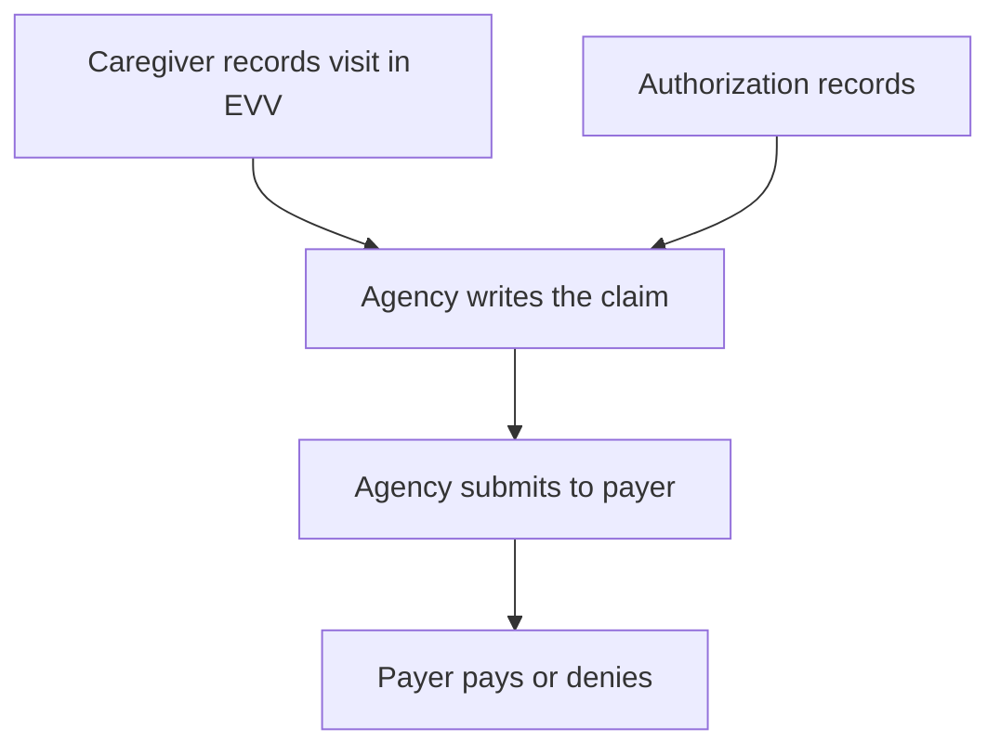
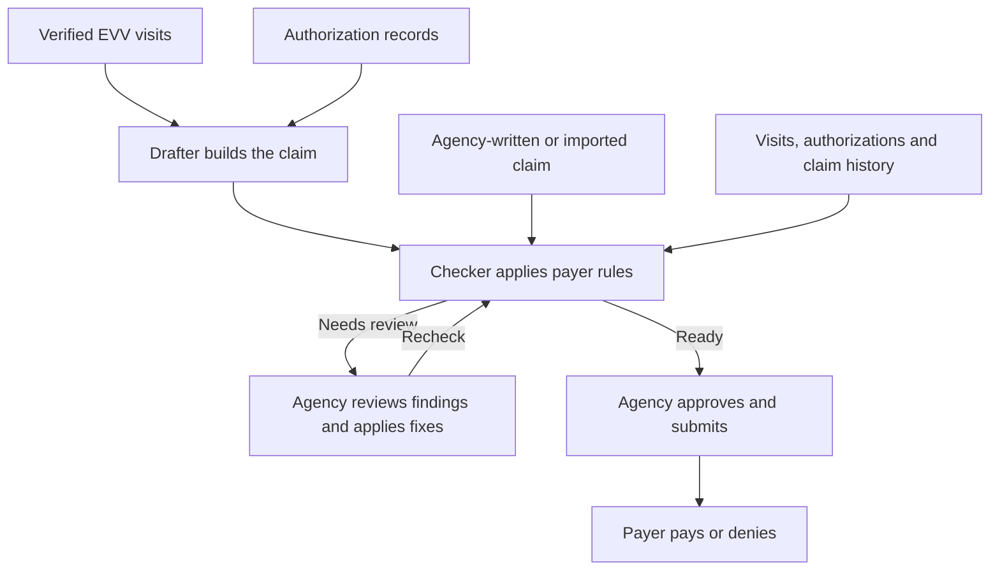
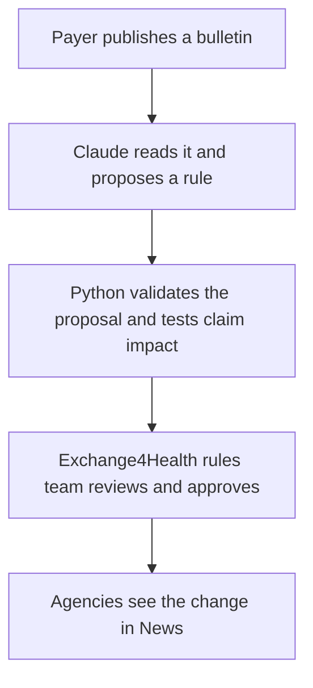

# Exchange4Health claims assistant

## Current workflow



## Proposed workflow



### New rule workflow



## What each piece does

- **[Checker](checker/README.md)** checks existing claims against payer rules, visit evidence, authorizations, and earlier submissions. It predicts the outcome, shows the evidence for each issue, and suggests what to fix.
- **[Drafter](drafter/README.md)** builds claims from verified visits, fills in the units, authorization, and modifier, then sends the drafts through the same checker.
- **[Interface](#open-the-demo)** lets agencies draft claims, review predicted denials and suggested fixes, and explore claims statistics.
- **AI** translates payer bulletins into proposed rules for the central team to review. It also helps interpret what the statistics say about the health of the claims process.

## Why rules and where AI helps

I chose a highly rule-based approach because billing is a regulated industry. Running the same claim through the same rules gives the same result, and each finding can be traced to the exact rule and data fields that triggered it.

Claude helps scale this approach as payer rules change. It translates a bulletin written in prose into a proposed rule that specifies which fields to check, what values to expect, and when the rule applies. Python validates and tests the proposal, and the central team decides whether to approve it. Claude also helps interpret claims statistics and investigate individual denials by tracing the relevant claims and records.

## How I used AI to build it

- I designed the [checker rules and decision flowcharts](checker/README.md) from the payer guidance and sample data. AI translated the rules into Python. I walked through the implementation to check that it used the right fields, dates, and conditions.
- I tested the checker's predictions against recorded payer outcomes in the [claims history](testing/README.md#baseline-results). I also traced a couple of denials through the underlying records to check that the reasons made sense.
- I decided where the checker and drafter fit in the billing workflow, what agency staff should see and do, and how the interface should look and work. I used AI to turn that design into the working demo.

## Open the demo

From the repository root, with Python 3.9 or later:

```bash
python3 -m venv .venv
.venv/bin/pip install -r requirements.txt
export E4H_DATA_DIR="/path/to/data-pack"
.venv/bin/streamlit run app/streamlit_app.py
```

Open [localhost:8501](http://localhost:8501). Choose **Agency AG009** or **Exchange4Health rules team** and enter any password. To use the Claude features, set `ANTHROPIC_API_KEY` before starting the app.
