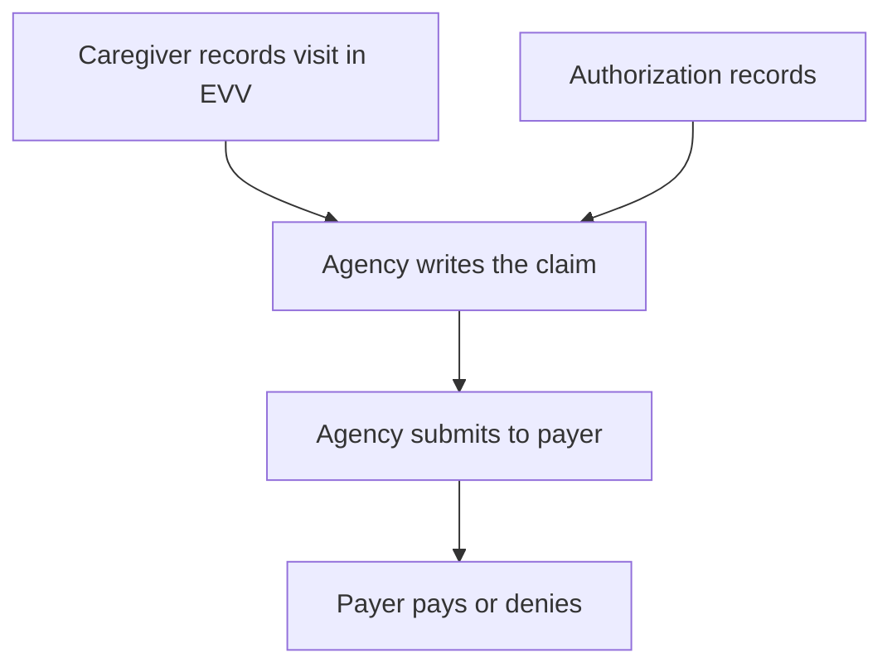
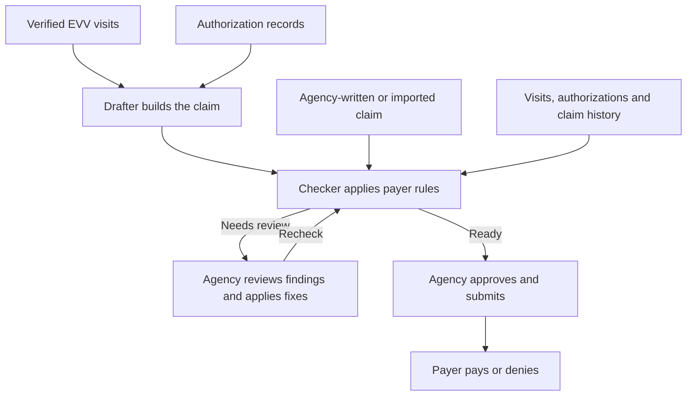
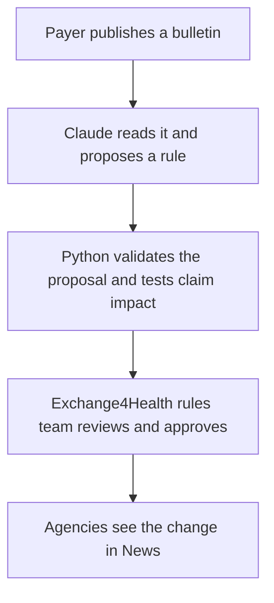

# Exchange4Health claims assistant

## Current workflow



## Proposed workflow



### New rule workflow



The checker uses the approved rule from its effective date. Each agency's News page shows the rule change and how many of its pending claims are affected.

## What each piece does

- **[Checker](checker/README.md)** checks existing claims against payer rules, visit evidence, authorizations, and earlier submissions. It predicts the outcome, shows the evidence for each issue, and suggests what to fix. [Download the assessment predictions](predictions.csv) or see the [historical test](testing/README.md).
- **[Drafter](drafter/README.md)** builds claims from verified visits, fills in the units, authorization, and modifier, then sends the drafts through the same checker.
- **Review app** gives agency staff a queue to inspect issues, approve fixes, and export claims that are ready. The rules team can review proposed payer-rule updates.

## Why rules and where AI helps

Python applies payer rules consistently. Each finding can be traced to a rule and the claim fields that triggered it, and each change can be tested against historical outcomes.

Claude helps with work that requires interpretation. It reads payer bulletins, investigates unexpected denials, and explains patterns in statistics calculated by Python. Python tests proposed rule changes against the data, and the rules team decides whether to approve them.

## How I used AI to build it

- I designed the [checker rules and decision flowcharts](checker/README.md) from the payer guidance and sample data. AI translated the rules into Python. I walked through the implementation to check that it used the right fields, dates, and checks, then validated the predictions against historical claims.
- I decided where the checker and drafter fit in the billing workflow, what agency staff should see and do, and how the website should look and work. I used AI to turn that design into the working demo.

## Open the demo

From the repository root, with Python 3.10 or later:

```bash
python3 -m venv .venv
.venv/bin/pip install -r requirements.txt
export E4H_DATA_DIR="/path/to/data-pack"
.venv/bin/streamlit run app/streamlit_app.py
```

Open [localhost:8501](http://localhost:8501). Choose **Agency AG009** or **Exchange4Health rules team** and enter any password. To use the Claude features, set `ANTHROPIC_API_KEY` before starting the app.
