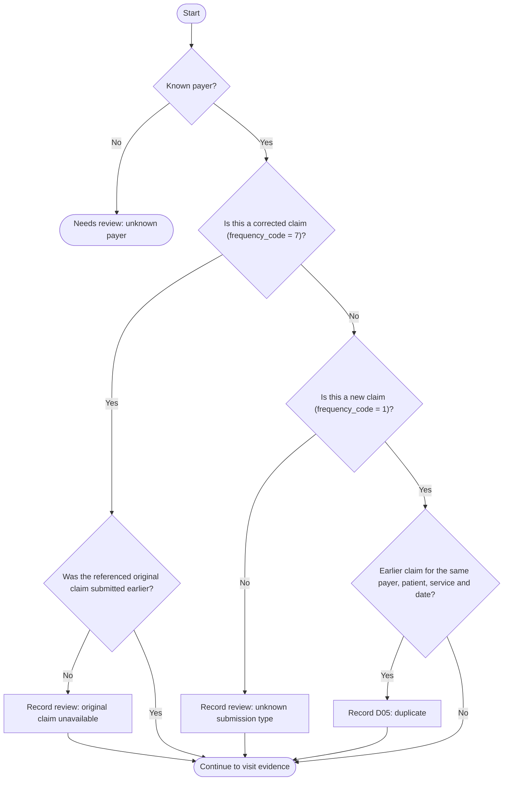
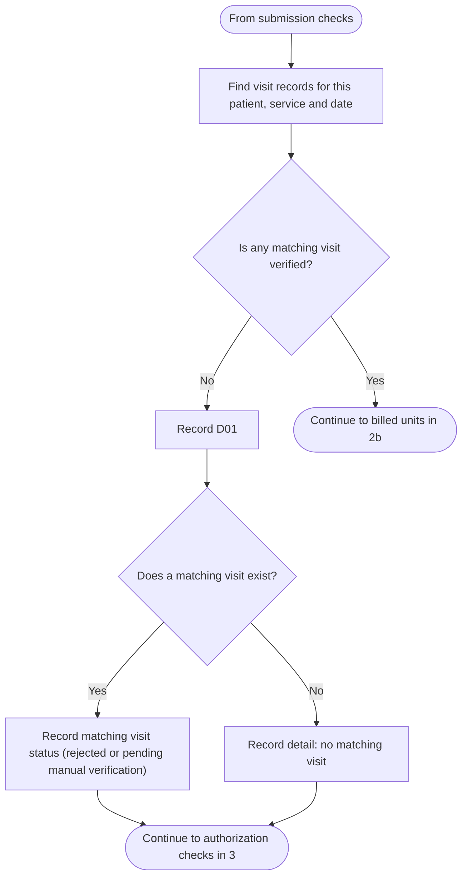
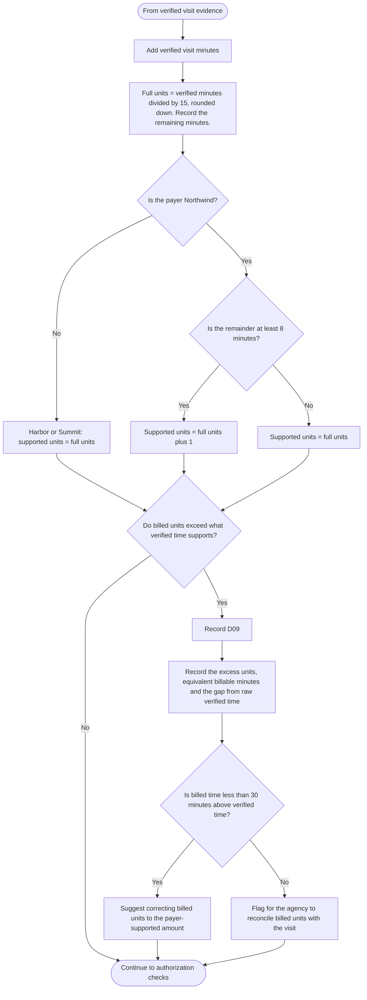
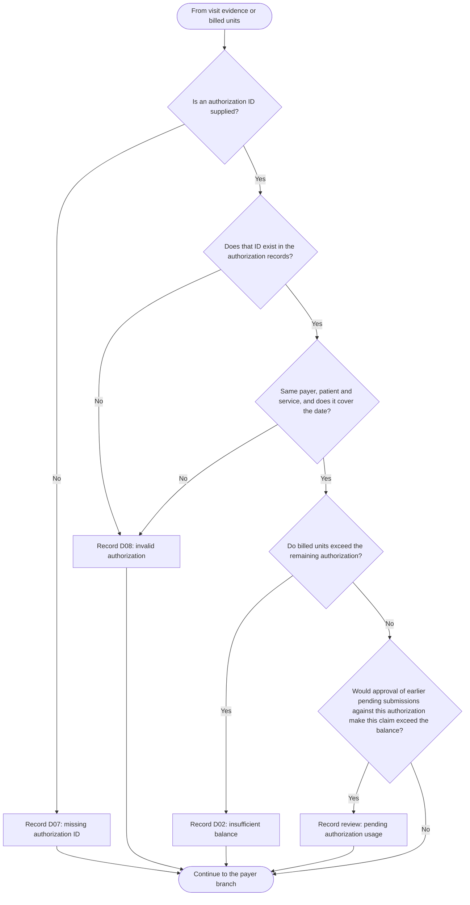
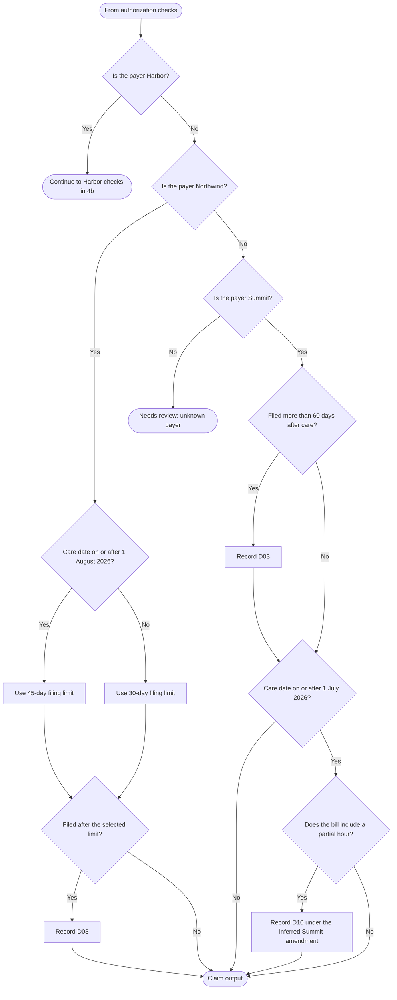
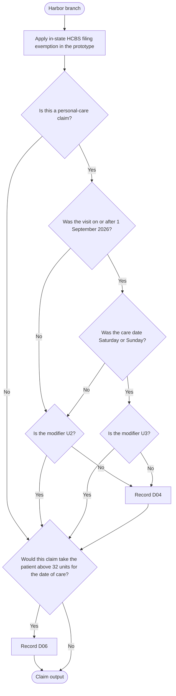
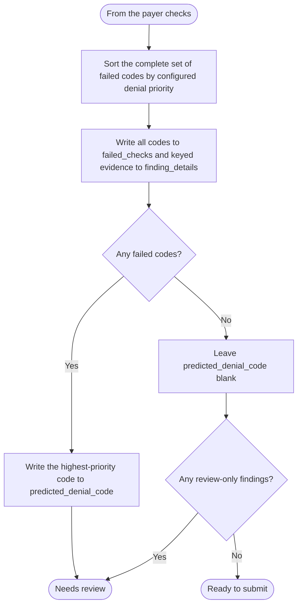

# Claim checker

The checker evaluates existing claims against verified visits, authorizations, submission history, and payer rules. Each applicable check runs, and the payer’s priority determines the predicted denial code.

The [structured output](#structured-output) supplies the evidence used by the app.

For the runnable historical evaluation, see the [testing guide](../testing/README.md).

## Assumptions

- **Summit whole-hour billing.** From 1 July 2026, Summit claims must bill in whole-hour increments of four 15-minute units. Drafting rounds verified billable time down to the nearest whole hour. For example, 1 hour 45 minutes supports 4 units. We inferred the requirement from historical denial remarks citing **Contract Amendment 3** and inferred the July start from the change in recorded outcomes.
- **Harbor filing.** We apply the in-state HCBS filing exemption to every Harbor claim in the sample because the export has no provider-state field.
- **Same-day submission order.** When submission dates tie within a CSV, earlier rows are treated as earlier submissions.
- **Pending authorization usage.** Earlier pending claims predicted to be paid provisionally reduce the remaining units for later claims.

#### 1. Payer and submission checks



#### 2a. Visit evidence



#### 2b. Billed units



Summit’s inferred whole-hour requirement is checked separately under its payer-specific rules.

#### 3. Authorization and balance



#### 4a. Select the payer and check Northwind or Summit



#### 4b. Harbor checks



#### 5. Produce the claim output



## Structured output

```python
from pathlib import Path
from checker.claim_checker import predict_pending_assessments

claims = predict_pending_assessments(Path("/path/to/data"))
```

For a CLI integration, run from the repository root:

```bash
python -m checker.claim_checker /path/to/data \
  --audit history_audit.csv --predictions predictions.csv --details findings.json
```

The JSON array follows `claims_to_check.csv` row order. Each item has `claim_id`, `payer`, `service_code`, `service_date`, `submission_date`, `status`, `predicted_denial_code`, `failed_checks`, `finding_details`, and `review_reasons`. Dates are ISO strings. Every failed code has one object with `evidence`, a `rule_reference` string, and a `suggested_action` key.

- Use `status` for the queue. Values are `ready_to_submit` and `needs_review`. A review-only item has an empty `failed_checks` list and a null `predicted_denial_code`.
- Render all findings in `failed_checks` order. The first code is the predicted denial code. The assessment CSV has separate `paid` and `denied` predictions, with only `claim_id,status,denial_code`.
- Use top-level service and submission dates for the current claim. Dates inside evidence refer to deadlines, prior submissions, or authorization coverage.
