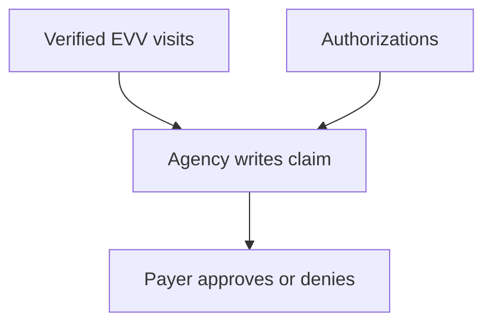
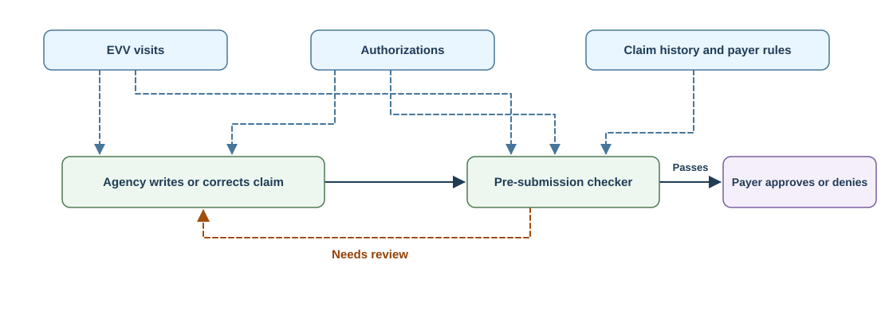
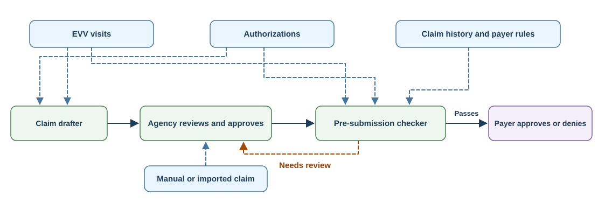
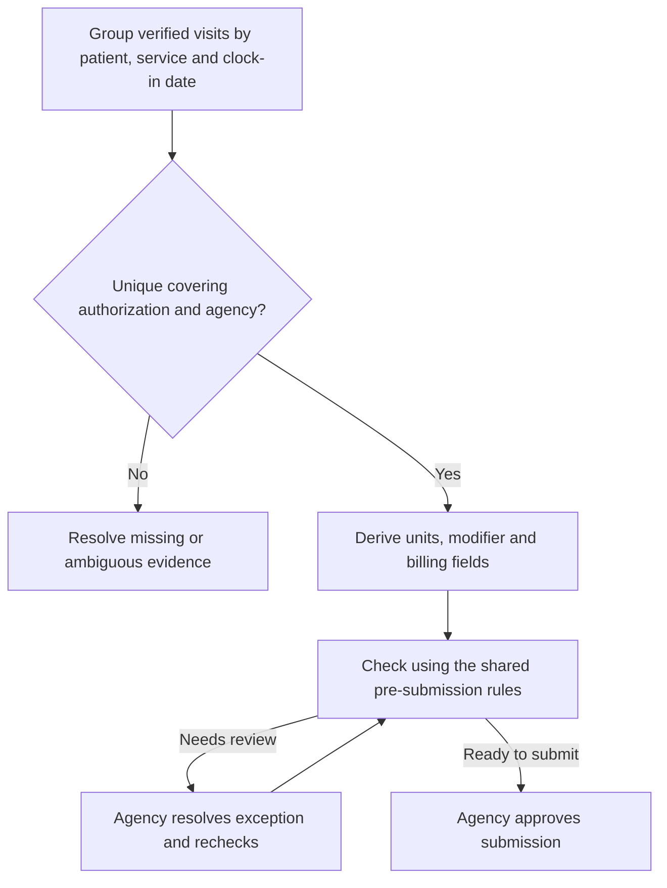
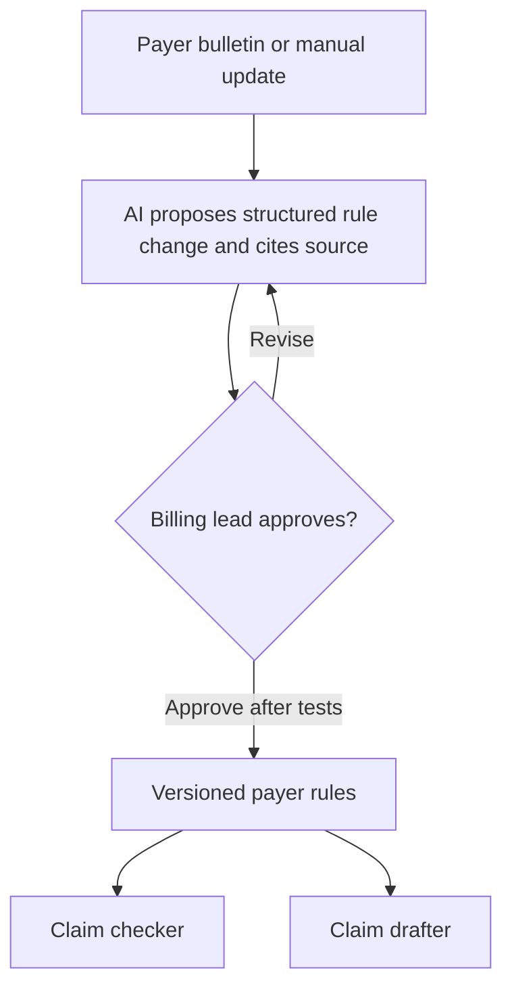

# Exchange4Health claim preparation

## Design decision

Use **one pre-submission checker** with two paths into it. Today the agency writes the claim. The first release checks that existing claim and lets the agency correct it. The next release can also create a draft from verified visits and authorizations. The agency then spends its time approving drafts and resolving exceptions. A manually entered claim can pass the same checks as an automated draft if its evidence and fields support it.

The checker returns **Ready to submit** or **Needs review**, along with all supported findings, the evidence, and the next action. A reviewer can correct the claim or resolve missing evidence and rerun the check. The payer makes the final payment or denial decision.

## Workflows

### Today

### First release · Check agency-authored claims

### Next release · Draft claims and keep the same checker

**Diagram key**

| Colour or line | Meaning |
|---|---|
| Blue boxes and dashed blue arrows | Inputs and where they are used. EVV is the electronic record of care delivered. Authorizations describe the care approved by the payer. Claim history supplies earlier submissions and usage. Payer rules supply the applicable requirements. |
| Green boxes and solid arrows | The claim moves from writing or drafting through the checker. |
| Dashed orange arrow | The checker returns the claim to the agency with findings. The agency resolves them and sends it back through the same checker. |
| Purple box | A passing claim moves to the payer, who makes the payment decision. |

In the first release, the checker is the final submission gate once the agency has put the claim into the workflow. In the drafting release, agency approval happens before release. The final check uses the latest duplicate, authorization and cap information.

See the [checker flowcharts](../checker/README.md) and [historical replay](../testing/README.md).

## Claim drafter

A short flow shows when a draft exists. The table shows where each field comes from.

| Draft field or decision | How the drafter gets it |
|---|---|
| Patient, service and date | Copy `patient_id` and `service_code` from EVV. Use the date of `clock_in` as `date_of_service`, including for overnight visits. Retain source `visit_id` values. Missing, rejected or pending EVV belongs in the visit exception workflow. |
| Payer and authorization | Find authorizations for the patient and service whose dates cover the visit date. The prototype requires one match and uses its `payer_id` and `auth_id`. Missing or ambiguous matches need agency review. |
| Agency and claim identity | Use the patient's agency assignment. The prototype derives a unique `agency_id` from history. Give the draft a `claim_id` and use `frequency_code = 1` for a new claim, with `original_claim_id` blank. Check for existing submissions before release. |
| Verified time and units | Sum verified time in the group and apply the payer's 15-minute unit rules. For the inferred Summit period, the prototype rounds down to complete hours. Zero billable units produce no draft. |
| Modifier and amount | Derive Harbor `T1019` `modifier` from the service date. Compute `billed_amount` from units and the service rate. The prototype uses rates inferred from the synthetic history. |
| Submission date | The replay uses the day after the latest clock-out. A live checker uses the planned or actual submission date, and the agency tracks deadlines for claims in review. |
| Authorization shortfall | Show required and remaining units and ask the agency to verify the balance or obtain additional authorization. Keep the claim in **Needs review** while unresolved. |
| Harbor cap reduction | If there is cap room left, propose the available units across that patient's same-day services. The agency confirms any reduction, and the checker reevaluates the reduced draft against the cap and authorization balance. If no units are available, keep it in review. |

## Where AI helps

### Maintain payer rules

The proposal includes payer, service, effective service dates, changed condition and source passage. Validate it against the rule format and test the date and value boundaries before activation. Claude Code can help developers implement and test the checker and drafter. A runtime model can draft rule proposals from payer text. The decision logic applies approved rules and records the version used.

### Help the agency resolve an exception

Start with an explanation inline on the claim. An optional AI explanation can use the checker's structured findings, approved rule excerpts, and relevant claim evidence to express the problem and next action in plain language. Standard messages for well-defined findings can be generated directly from the rule result. The agency reviews the evidence and confirms any edit.

For a small D09 discrepancy, show verified minutes, billed units and units supported by the actual payer rule. If the billed amount fits a tested rounding pattern, mention rounding as a possibility. The proposed correction still comes from the payer rule. For an authorization shortfall, show the remaining units and what the agency needs to check. A chatbot can be considered later if billers need follow-up questions about those findings.

## Prototype boundary

The current prototypes run on the supplied synthetic files. The historical checker evaluates agency-authored claims, and the drafter experiment constructs claims from verified EVV and routes them through the checker. The diagrams describe the proposed agency interface, shared rule publication workflow and payer handoff. The AI bulletin review and explanation features are design proposals. A useful first demo is the checker with one clear correction and one issue requiring agency review.
