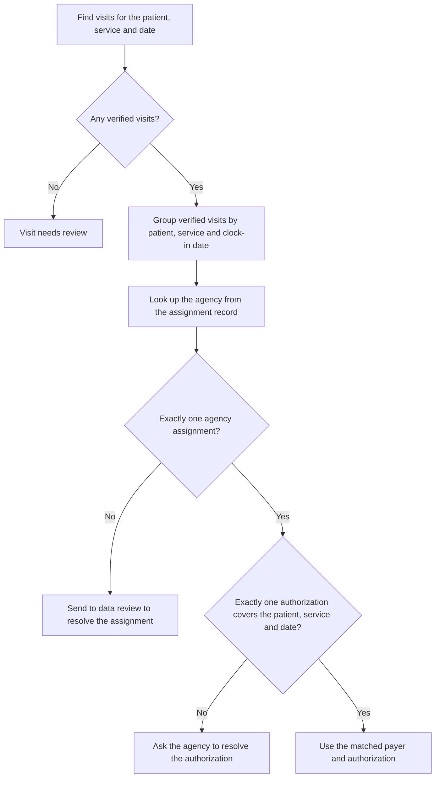
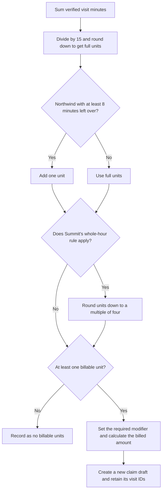
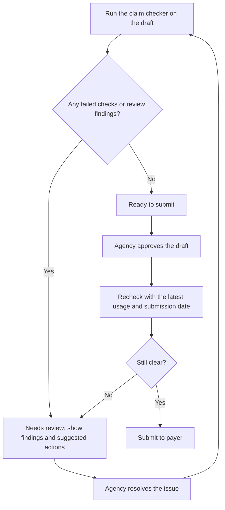
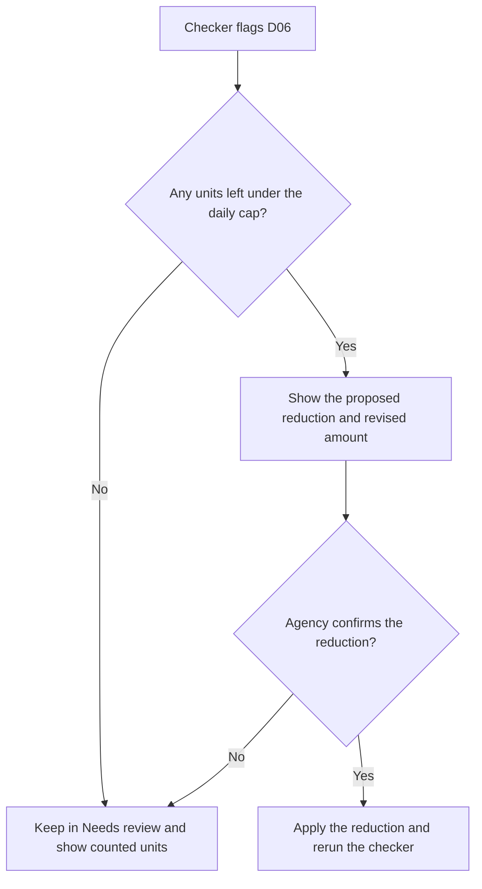

# Claim drafter

The claim drafter turns verified visits into draft claims. It assigns the payer and authorization, calculates billable units, and sends each draft through the [claim checker](../checker/README.md). The flowcharts describe the proposed agency workflow. [The Python prototype](claim_drafter.py) simulates drafting and review decisions on the synthetic data.

## 1. Find the visit, agency and authorization

All 300 patients in `claims_history.csv` appeared under exactly one agency. The prototype uses that patient-to-agency lookup because the EVV export has no `agency_id`. In a live system, the agency can come from the visit’s scheduling record or the agency account that supplied it.

## 2. Build the draft

For Harbor personal care, set `U3` for weekends from 1 September 2026 and `U2` otherwise. The Summit branch uses the whole-hour requirement inferred for the prototype.

## 3. Check, review and submit

For an authorization shortfall, show requested units, available units and the difference. Keep the draft in review while the agency resolves the balance.

## 4. Review a Harbor cap reduction

