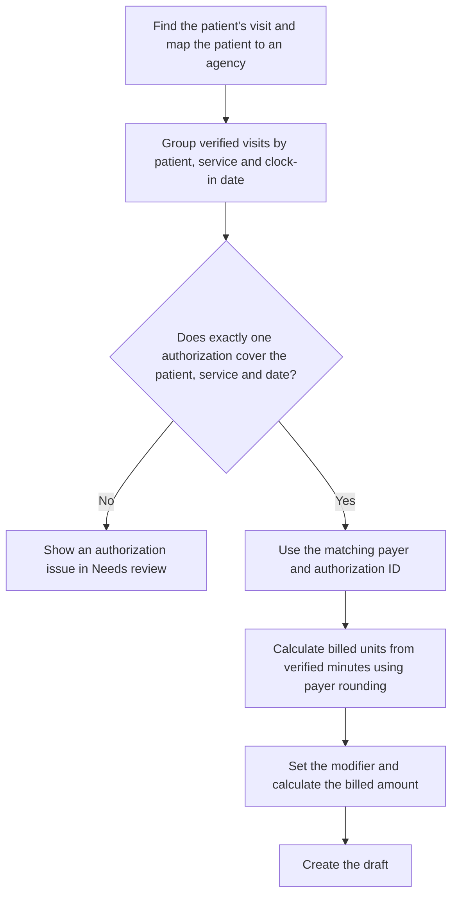
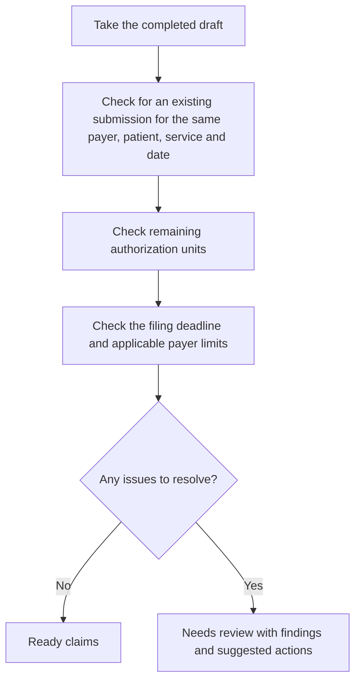

# Claim drafter

The [claim drafter](claim_drafter.py) turns verified visits into drafts. It builds each draft from the visit and payer rules, then runs the [shared claim checker](../checker/README.md) to decide whether it is ready to submit or needs review.

## 1. Build the draft

All 300 patients in `claims_history.csv` appeared under exactly one agency. The prototype uses that mapping because the EVV export has no `agency_id`. Finding the authorization gives the draft its payer and authorization ID. The checker evaluates the available units in the next stage.

## 2. Check the draft

## Issues drafting prevents

- **Overbilling verified time (D09)** — calculates units from verified minutes using payer rules.
- **Wrong or missing Harbor modifier (D04)** — sets the required modifier.
- **Missing or invalid authorization ID (D07/D08)** — fills the ID when exactly one authorization covers the visit.
- **Partial-hour Summit billing (D10)** — applies the inferred whole-hour rule.

## Issues that still need review

- **Missing or unverified visit (D01)** — drafting needs verified visit evidence.
- **Missing or ambiguous authorization** — the agency must identify the right authorization.
- **Insufficient authorization units (D02)** — the agency must verify the balance or obtain more units.
- **Possible duplicate (D05)** — the agency must check whether an earlier claim needs correcting.
- **Harbor daily cap exceeded (D06)** — the agency must confirm any reduction.

See the [drafter tests and results](../testing/README.md#claim-drafter-testing).
