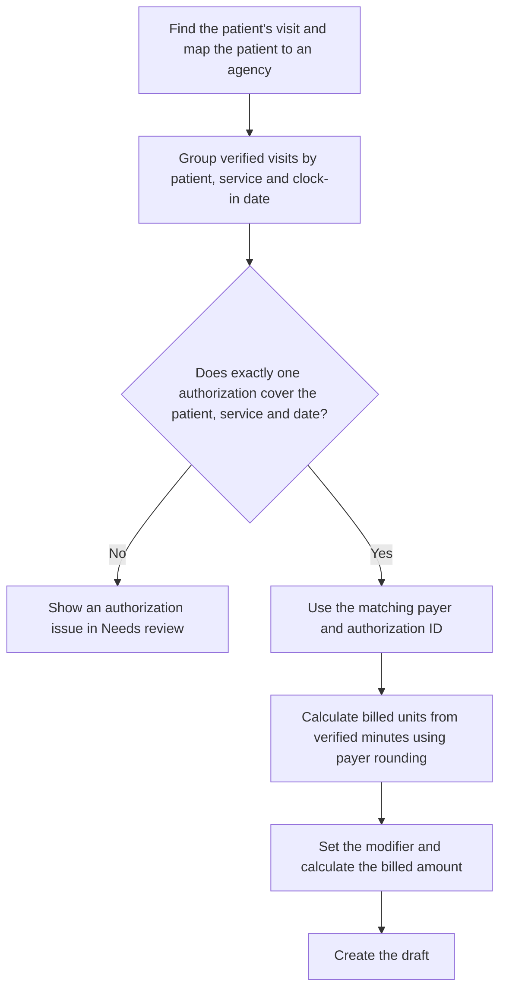
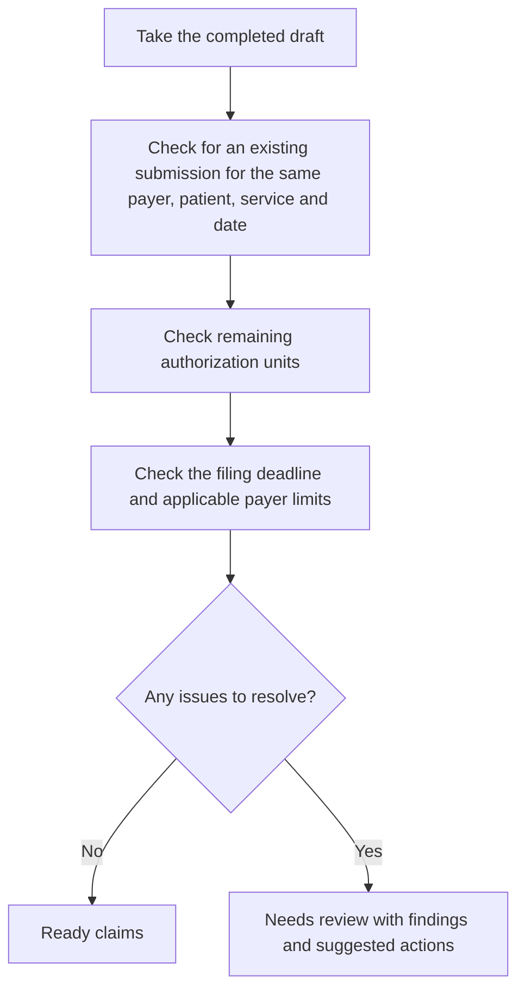

# Claim drafter

The [claim drafter](claim_drafter.py) turns verified visits into drafts. It builds each draft from the visit and payer rules, then runs the [shared claim checker](../checker/README.md) to decide whether it is ready to submit or needs review.

## 1. Build the draft

All 300 patients in `claims_history.csv` appeared under exactly one agency. The prototype uses that mapping because the EVV export has no `agency_id`. Finding the authorization gives the draft its payer and authorization ID. The checker evaluates the available units in the next stage.

## 2. Check the draft

## Which issues need human review?

| Handling | Issues and action |
|---|---|
| Resolved during drafting | Calculate payer-supported units from verified time (D09), set Harbor’s required modifier (D04), and fill the authorization ID when exactly one record covers the visit (D07 and D08). The prototype also applies the inferred Summit whole-hour rule (D10). |
| Human action required | For insufficient authorization balance (D02), show requested units, remaining units, and the shortfall. The agency verifies the balance or obtains authorization for the additional units. Missing or ambiguous authorizations and missing or unverified visit evidence also require review. |
| Human review initially, with a possible automation later | For a duplicate (D05), show the prior submission so the agency can tell a repeat entry from a legitimate correction. A future workflow could block confirmed duplicate new claims automatically. For the Harbor cap (D06), show the excess units and proposed billed amount, then let the agency confirm one or several reductions. A future visit record could capture documented non-billable breaks and subtract them from billable time before drafting. |

After a Harbor reduction, rerun the checker so the draft still has to pass the authorization check and other applicable rules. See the [drafter tests and results](../testing/README.md#claim-drafter-testing).
